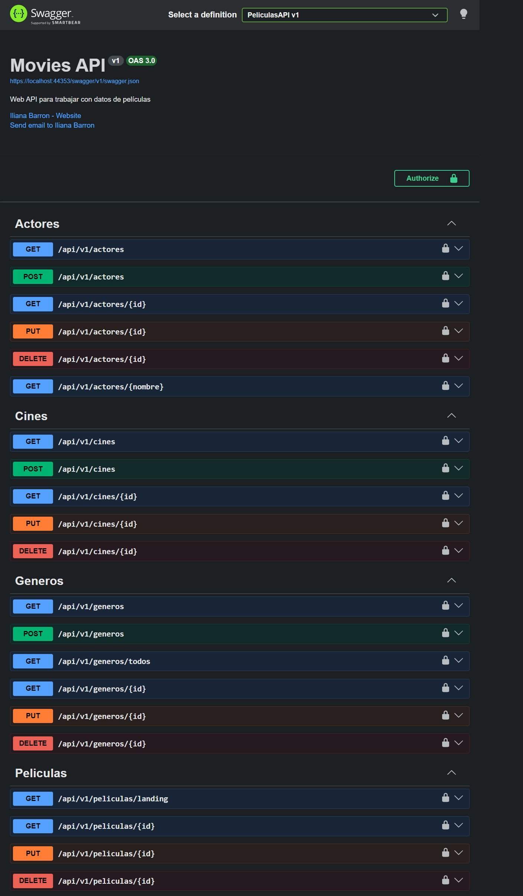
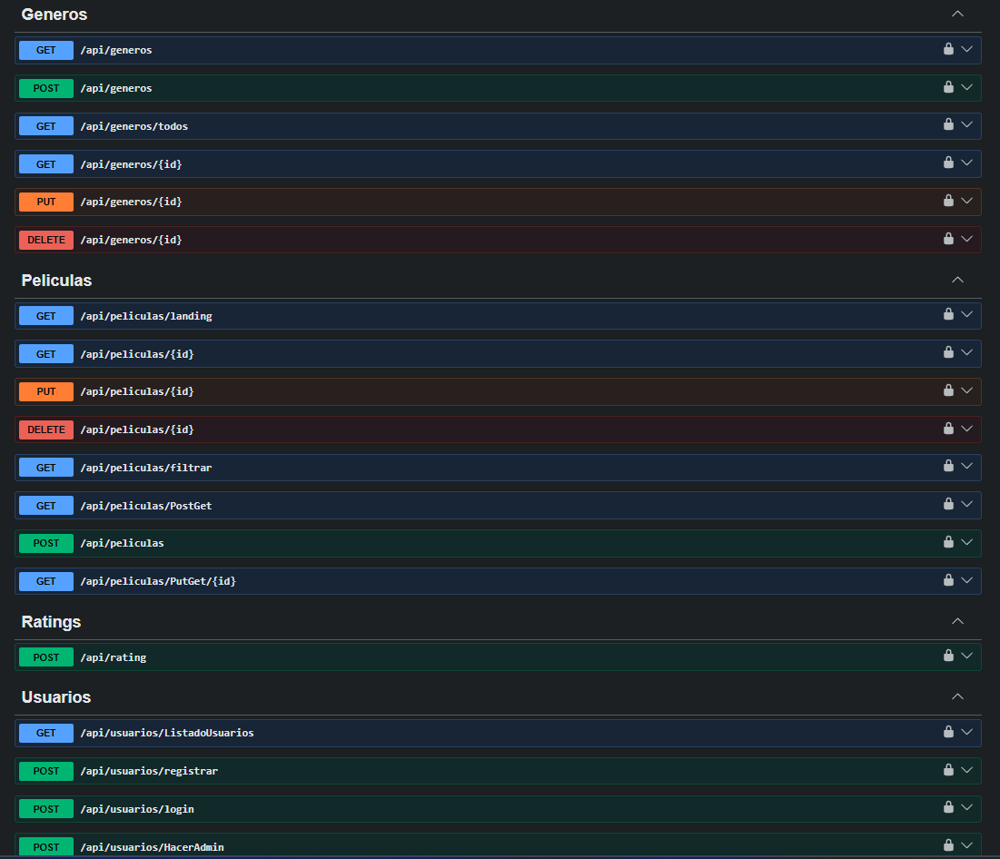
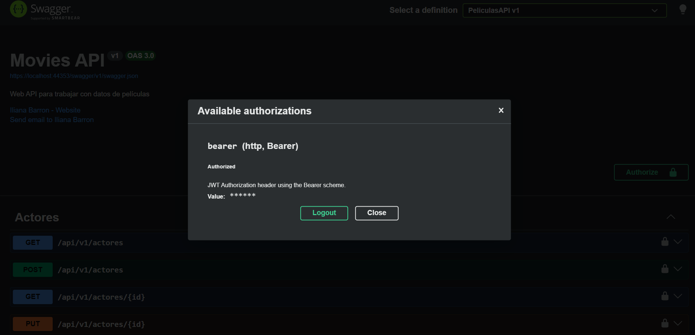
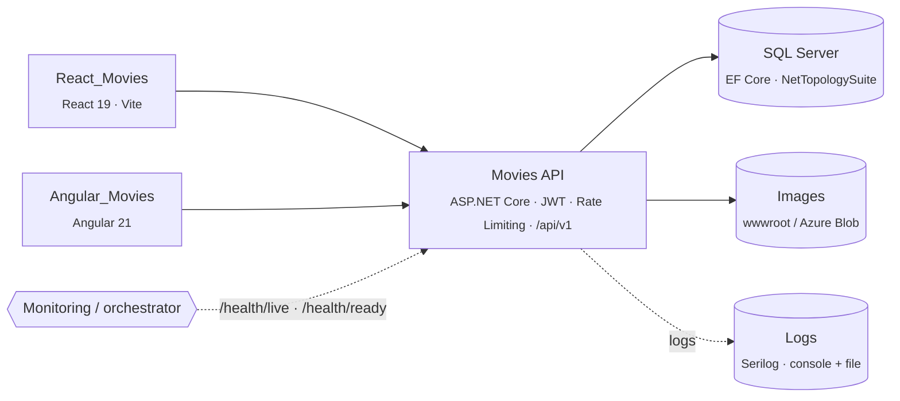

🇪🇸 [Español](README.md)&nbsp;|&nbsp;🇬🇧 English

# 🎬 Movies API — ASP.NET Core Web API

REST API built with **ASP.NET Core (.NET 10)** and **Entity Framework Core** to manage a movie catalog: genres, actors, cinemas with geographic location, movies, and user ratings. It is the backend for two client applications that consume it:

- [React_Movies](https://github.com/iliana212/React_Movies) — React 19 + TypeScript
- [Angular_Movies](https://github.com/iliana212/Angular_Movies) — Angular 21

      

*Route, class and entity names (`generos`, `peliculas`, `cines`, `esadmin`…) are kept as-is from the actual codebase — they are Spanish for genres, movies, cinemas and "is admin".*

> **Status:** actively in development.

  

## At a glance

- 6 resources (genres, actors, cinemas, movies, ratings and users) exposed through REST controllers, **DTOs** and **AutoMapper**
- **JWT** authentication with ASP.NET Core Identity and claim-based authorization (`esadmin`)
- **Geospatial data** with NetTopologySuite for cinema locations
- Image uploads (movie posters and actor photos) with **local** or **Azure Blob Storage**, swappable through an interface
- Movie filtering, pagination, tag-based **output caching**, and **Swagger / OpenAPI** documentation
- **Production-minded:** API versioning, rate limiting on authentication, global error handling with `ProblemDetails`, health checks, and structured logging with Serilog
- **Tested:** unit and integration tests with xUnit, run against a real SQL Server in a container

## Architecture



## Main endpoints

Every API route carries the version in the URL (`/api/v1/...`). The health endpoints are not versioned, since they are infrastructure rather than part of the API contract.

| Resource | Routes | Access |
| --- | --- | --- |
| Genres | `api/v1/generos` (CRUD) · `GET api/v1/generos/todos` | Admin (`todos` is public) |
| Actors | `api/v1/actores` (CRUD) · `GET api/v1/actores/{nombre}` (search by name) | Admin |
| Cinemas | `api/v1/cines` (CRUD) | Admin |
| Movies (read) | `GET api/v1/peliculas/landing` · `GET api/v1/peliculas/{id}` · `GET api/v1/peliculas/filtrar` | Public |
| Movies (management) | `POST` / `PUT` / `DELETE api/v1/peliculas` · `GET PostGet` · `GET PutGet/{id}` | Admin |
| Ratings | `POST api/v1/rating` | Authenticated user |
| Users | `POST api/v1/usuarios/registrar` · `POST api/v1/usuarios/login` (rate limited) | Public |
| User administration | `GET ListadoUsuarios` · `POST HacerAdmin` · `POST RemoverAdmin` | Admin |
| Health | `GET /health/live` · `GET /health/ready` | Public |

- **Landing:** movies currently in theaters and upcoming releases.
- **Details:** include the average rating and the authenticated user's own vote.
- **Filter:** by title, genre, in theaters, and upcoming releases, with pagination (maximum 50 records per page).
- The total record count is returned in the `cantidad-total-registros` response header.

## Production features

Beyond the endpoints, these are the pieces that make the API more robust and easier to operate:

- **API versioning** — version in the URL (`/api/v1/...`) using `Asp.Versioning`. Every response advertises the available versions in the `api-supported-versions` header, and unversioned routes return `404`. It makes it possible to introduce breaking changes in a `v2` without breaking clients that are still on `v1`.
- **Rate limiting on authentication** — `POST api/v1/usuarios/login` allows 5 attempts per minute per IP, and `POST api/v1/usuarios/registrar` allows 3 every 10 minutes (fixed window). When exceeded, the API responds with `429` and a `Retry-After` header. This reduces the risk of brute-force attacks and mass account creation.
- **Global exception handling** — a centralized `IExceptionHandler` returns every error in the standard `ProblemDetails` format: unique-constraint violations → `409`, invalid references (foreign key) → `400`, concurrency conflicts → `409`, and unexpected errors → `500` with a generic message (the real detail is only shown in Development). Every response includes a `traceId` to correlate it with the logs.
- **Health checks** — `/health/live` (liveness: the process is alive, no dependencies queried) and `/health/ready` (readiness: verifies the SQL Server connection through EF Core). Both return JSON with the status of each check, without exposing exception messages. This is the pattern Docker and Kubernetes expect.
- **Structured logging with Serilog** — output to the console and to a daily rolling file (`logs/api-.log`, 14 days retained). Each request logs a summary with its `RequestId` and the authenticated user; that `RequestId` matches the `traceId` in error responses, so an error reported by a client can be traced back to its log line. Levels are configured in the `Serilog` section of `appsettings.json`.

## Testing

The `PeliculasAPI.Tests` project combines two levels of tests with **xUnit**:

| Level | What it covers | How it runs |
| --- | --- | --- |
| **Unit** | Custom validation (`PrimeraLetraMayuscula`), pagination, AutoMapper mappings (including the latitude/longitude ↔ `Point` conversion), `TypeBinder`, the global exception handler, and `ServicioUsuarios` | No external dependencies |
| **Integration** | The real API through `WebApplicationFactory`: versioning, health checks, CRUD for genres, cinemas, actors and movies, filters and pagination, ratings, register/login, user administration, and rate limiting | Against a real SQL Server in a container (**Testcontainers**) |

Test design decisions:

- **Real SQL Server, not an in-memory database:** the model uses `geography` columns (NetTopologySuite), which the EF Core in-memory provider does not support. The real migrations are also applied on startup, so the schema creation is tested too.
- **Simulated authentication without going through login:** tests generate JWT tokens signed with the test key, so they do not consume the rate-limiting quota. Each request simulates a different client IP through a test header, which also makes it possible to verify that the limit is per IP.
- **Fake file storage:** `IAlmacenadorArchivos` is replaced by an in-memory implementation so nothing is written to `wwwroot` and there is no dependency on Azure.
- **Unique data per test:** all tests share the same database, so each one creates its own data with unique names and does not depend on the others.

### Running the tests

Requires **Docker** to be running (the first run downloads the SQL Server image).

```bash
dotnet test                                                                # all tests
dotnet test --filter "FullyQualifiedName~PeliculasAPI.Tests.Unit"          # unit tests only
dotnet test --filter "FullyQualifiedName~PeliculasAPI.Tests.Integration"   # integration tests only
```

## Tech stack

| Area | Technology |
| --- | --- |
| Framework | ASP.NET Core Web API, .NET 10 |
| Data access | Entity Framework Core 10, SQL Server, code-first migrations |
| Spatial data | NetTopologySuite (SRID 4326) |
| Security | ASP.NET Core Identity, JWT Bearer, Rate Limiting |
| Versioning | Asp.Versioning.Mvc (URL segment) |
| Error handling | `IExceptionHandler` + `ProblemDetails` |
| Observability | Serilog (console + file), ASP.NET Core Health Checks |
| Testing | xUnit, `WebApplicationFactory`, Testcontainers (SQL Server), NSubstitute |
| Mapping | AutoMapper |
| Storage | Local file system / Azure Blob Storage |
| Docs | Swashbuckle (Swagger UI) |

## Project structure

```
├── Controllers/        # API endpoints
├── DTOs/               # Data transfer objects
├── Entidades/          # EF Core entities
├── Migrations/         # Database migrations
├── Servicios/          # Services (users, file storage)
├── Utilidades/         # AutoMapper profiles, cache policy, global exception handler, extensions
├── Validaciones/       # Custom validation attributes
├── PeliculasAPI.Tests/ # Tests
│   ├── Unit/           #   Unit tests
│   └── Integration/    #   Integration tests and infrastructure (API factory, SQL Server container)
├── logs/               # Log files generated by Serilog (not versioned)
├── wwwroot/            # Static files / uploaded images
├── ApplicationDBContext.cs
└── Program.cs          # Service registration and HTTP pipeline
```

## Getting started

### Prerequisites

- [.NET 10 SDK](https://dotnet.microsoft.com/download)
- SQL Server (LocalDB, Express, Docker, or a full instance)
- EF Core CLI: `dotnet tool install --global dotnet-ef`
- Docker (only to run the integration tests)

### 1. Clone the repository

```bash
git clone https://github.com/iliana212/API_Movies.git
cd API_Movies
```

### 2. Configure secrets

`appsettings.json` intentionally contains no connection strings or keys. Set them with [user secrets](https://learn.microsoft.com/aspnet/core/security/app-secrets) (or an `appsettings.Development.json` that is **not** committed):

```bash
dotnet user-secrets init
dotnet user-secrets set "ConnectionStrings:DefaultConnection" "Server=(localdb)\\MSSQLLocalDB;Database=PeliculasDB;Trusted_Connection=True;TrustServerCertificate=True"
dotnet user-secrets set "Jwt:Issuer" "https://localhost"
dotnet user-secrets set "Jwt:Audience" "https://localhost"
dotnet user-secrets set "Jwt:llavejwt" "<a-long-random-string-of-at-least-32-characters>"
dotnet user-secrets set "origenesPermitidos" "http://localhost:5173,http://localhost:4200"
```

| Key | Purpose |
| --- | --- |
| `ConnectionStrings:DefaultConnection` | SQL Server connection string |
| `Jwt:Issuer` / `Jwt:Audience` | Expected issuer and audience of the tokens |
| `Jwt:llavejwt` | Symmetric key used to sign JWT tokens |
| `origenesPermitidos` | Comma-separated origins allowed by CORS (React on `5173`, Angular on `4200` by default) |
| `ConnectionStrings:AzureStorageConnection` | Only if you use Azure Blob Storage |

### 3. Create the database

```bash
dotnet ef database update
```

### 4. Run the API

```bash
dotnet run --launch-profile https
```

Swagger UI will be available at `https://localhost:7263/swagger`. Logs are written to the console and to the `logs/` folder.

### 5. Check that the API is healthy

```bash
curl -k https://localhost:7263/health/live
curl -k https://localhost:7263/health/ready
```

`live` returns `200` as long as the process is alive; `ready` returns `200` if the database is reachable and `503` if it is not.

### 6. Create the first administrator

Management endpoints require the `esadmin` claim, and only an administrator can grant it. For the very first user:

1. Register it with `POST api/v1/usuarios/registrar` from Swagger.
2. Add the claim directly in the database:

```sql
INSERT INTO AspNetUserClaims (UserId, ClaimType, ClaimValue)
SELECT Id, 'esadmin', 'true' FROM AspNetUsers WHERE Email = 'your-email@example.com';
```

From then on, that administrator can promote other users through `POST api/v1/usuarios/HacerAdmin`.

### Authenticating in Swagger

Sign in with `POST api/v1/usuarios/login`, copy the token, click **Authorize**, and paste it.

### Switching file storage to Azure Blob Storage

Images are saved under `wwwroot` by default. To use Azure, change the `IAlmacenadorArchivos` registration in `Program.cs` from `AlmacenadorArchivosLocal` to `AlmacenadorArchivosAzure` and add the `ConnectionStrings:AzureStorageConnection` setting.

## Related projects

| Project | Description |
| --- | --- |
| [React_Movies](https://github.com/iliana212/React_Movies) | React + TypeScript client |
| [Angular_Movies](https://github.com/iliana212/Angular_Movies) | Angular client |

## Author

**Iliana Barron** — [@iliana212](https://github.com/iliana212)
